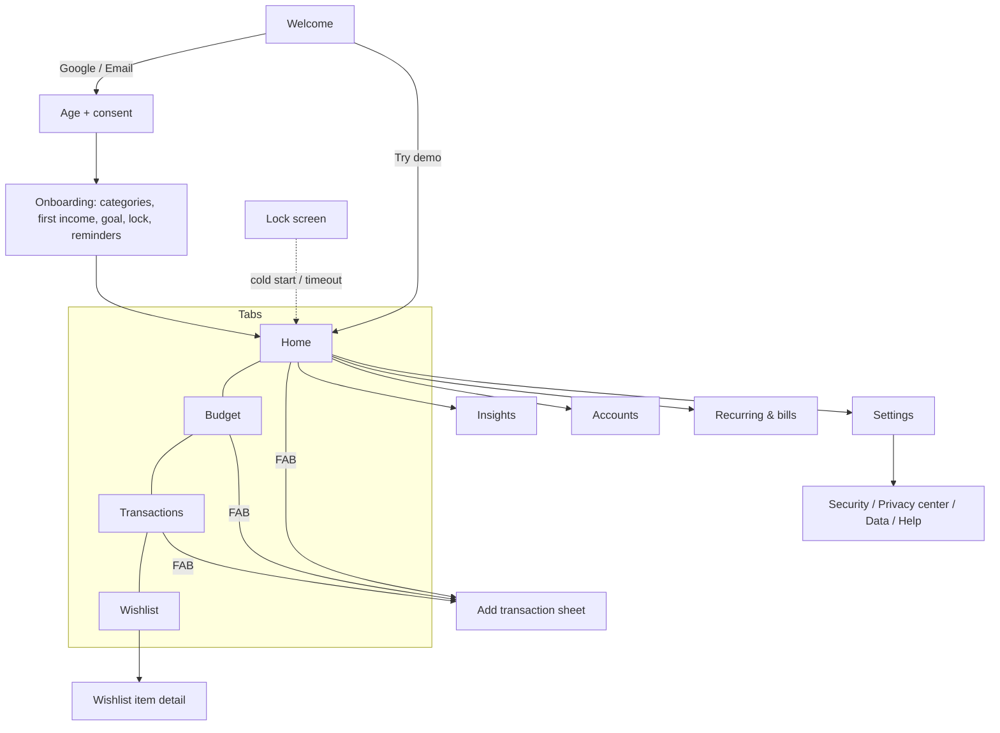
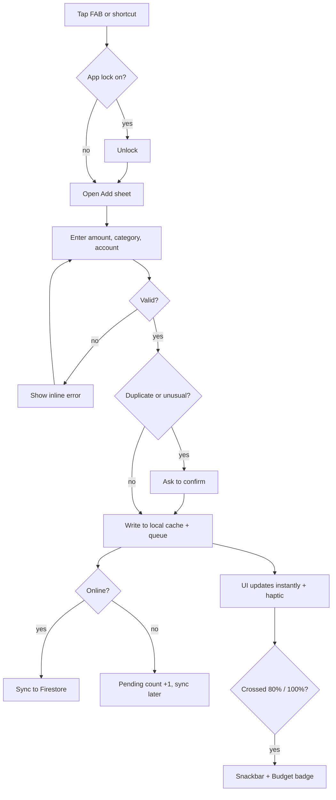
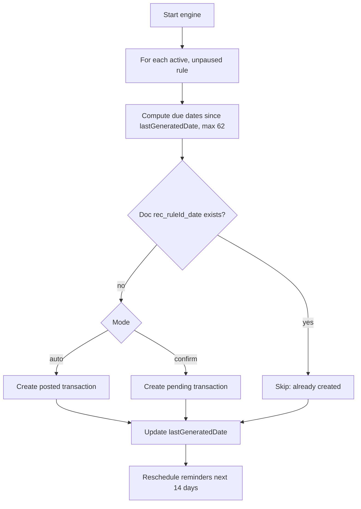
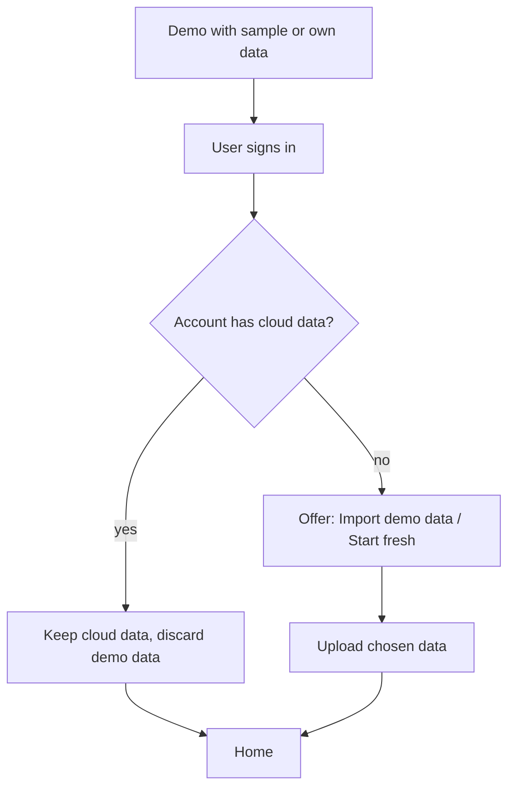
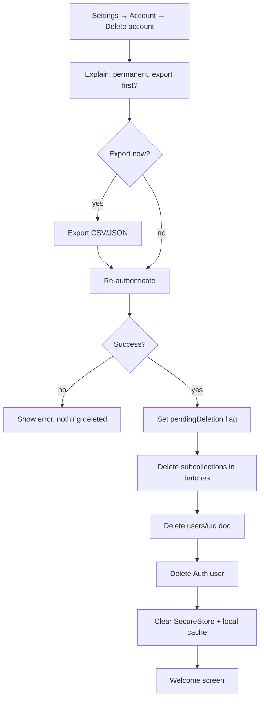
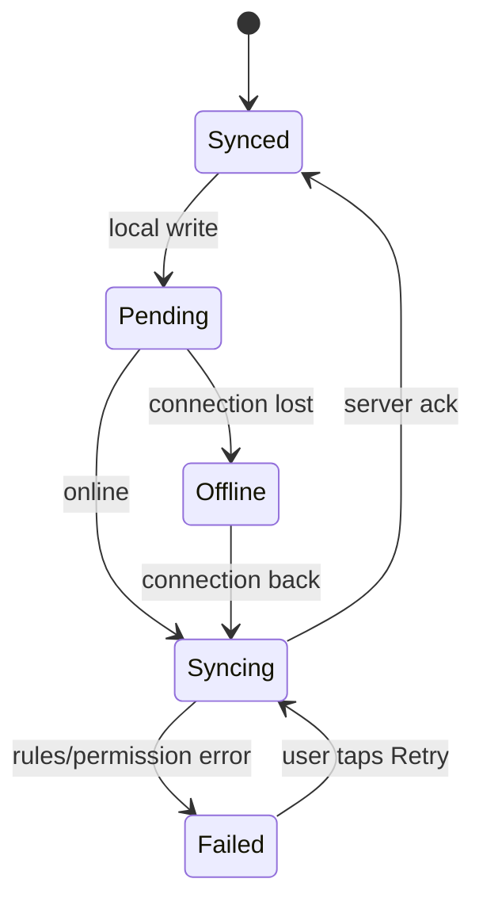
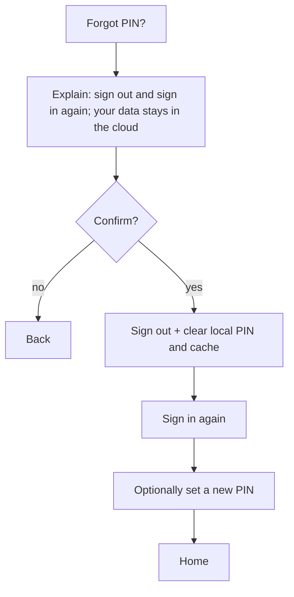

# Wireframes, User Flows & Microcopy Rules

Companion to `DESIGN_SYSTEM.md`. Wireframes are **layout and hierarchy only**: colors, type, radii and spacing come from the design tokens (§4). Phone width ≈ 360–412dp. `▓` = filled `primary` surface, `░` = tinted surface, `▒` = skeleton/placeholder. Labels in `‹ ›` are tappable.

---

## 1. Navigation map



---

## 2. Screen wireframes

### 2.1 Welcome

```
┌────────────────────────────────────┐
│                                    │
│              [ logo ]              │
│          <APP_NAME>                │
│   Give every cedi a job.           │
│                                    │
│  ┌──────────────────────────────┐  │
│  │ ▓ Continue with Google ▓     │  │  primary button
│  └──────────────────────────────┘  │
│  ┌──────────────────────────────┐  │
│  │   Use email                  │  │  outline button
│  └──────────────────────────────┘  │
│        ‹ Try the demo ›            │  text button
│                                    │
│  By continuing you accept the      │
│  ‹Terms› and ‹Privacy Policy›      │
└────────────────────────────────────┘
```

### 2.2 Age and consent

```
┌────────────────────────────────────┐
│ ‹ ←                                │
│ Before we start                    │
│                                    │
│ ☐ I am 16 or older                 │
│ ☐ I accept the ‹Terms› and         │
│   ‹Privacy Policy›                 │
│                                    │
│ If you are under 18, a parent or   │
│ guardian has agreed to your use.   │
│                                    │
│ ┌──────────────────────────────┐   │
│ │  ▓ Continue ▓ (disabled until│   │
│ │    both are ticked)          │   │
│ └──────────────────────────────┘   │
└────────────────────────────────────┘
```

### 2.3 Home (bento dashboard)

```
┌────────────────────────────────────┐
│ ‹ October 2026 ›            👁  ●  │  month, quick-hide, sync dot
├────────────────────────────────────┤
│ ┌────────────────────┐ ┌─────────┐ │
│ │▓ Unassigned        │ │░ 💰     │ │
│ │▓ ₵1,250.00         │ │░ Saved  │ │
│ │▓ still needs a job │ │░ ₵400.00│ │
│ └────────────────────┘ └─────────┘ │  hero 2/3 + companion 1/3
│ ┌──────────────┐ ┌───────────────┐ │
│ │ Income       │ │ Spent         │ │
│ │ ₵4,500.00    │ │ ₵2,850.00     │ │
│ │ ▲ 5% vs Sep  │ │ ▼ 3% vs Sep   │ │
│ └──────────────┘ └───────────────┘ │
│ ┌────────────────────────────────┐ │
│ │ You can spend about ₵62.00     │ │  safe to spend
│ │ today · 14 days left           │ │
│ └────────────────────────────────┘ │
│ ┌──────────────┐ ┌───────────────┐ │
│ │ Net ₵3,120   │ │ Bills (3)     │ │  accounts + upcoming
│ │ Available    │ │ ECG  25 Oct   │ │
│ │ ₵2,720       │ │ Rent  1 Nov   │ │
│ └──────────────┘ └───────────────┘ │
│ Top categories                     │
│ (🛒 ₵620) (🚌 ₵310) (🏠 ₵900) ›    │  horizontal scroll
│ ┌────────────────────────────────┐ │
│ │ 💻 Laptop        62% saved     │ │
│ │ ███████████░░░░░░              │ │
│ └────────────────────────────────┘ │
│ Charts           ‹See all›         │
│  ( donut )        ( line chart )   │
├────────────────────────────────────┤
│ 🏠 Home  📊 Budget  🧾 Txns  🎯 Wish│
└────────────────────────────────────┘
                              ( ＋ )   FAB bottom-right
```

### 2.4 Add transaction (bottom sheet)

```
┌────────────────────────────────────┐
│ ───  (drag handle)                 │
│ [Expense] [Income] [Saving] [Transfer]
│ Quick add:  (Bolt ₵25) (Lunch ₵30) │  templates
│                                    │
│            ₵ 0.00                  │  large amount
│  ┌───┬───┬───┬───┐                 │
│  │ 7 │ 8 │ 9 │ ÷ │  numeric keypad │
│  │ 4 │ 5 │ 6 │ × │  with calculator│
│  │ 1 │ 2 │ 3 │ − │  keys           │
│  │ . │ 0 │ ⌫ │ + │                 │
│  └───┴───┴───┴───┘                 │
│ Category  (🛒)(🚌)(🏠)(🍽️)(＋) ›     │
│ Account   ‹ 📲 MoMo ▾ ›            │
│ Date      ‹ Today ▾ ›              │
│ Note      [ optional ........... ] │
│ Repeat    ‹ Never ▾ ›              │
│ ┌──────────────────────────────┐   │
│ │        ▓ Save ▓              │   │
│ └──────────────────────────────┘   │
└────────────────────────────────────┘
```

Transfer variant: Category row is replaced by `From ‹Cash ▾›  →  To ‹MoMo ▾›`.

### 2.5 Budget

```
┌────────────────────────────────────┐
│ ‹ October 2026 ›              ⋮    │
│ Income ₵4,500 · Assigned ₵3,250    │
│ Unassigned ₵1,250                  │
├────────────────────────────────────┤
│ (🏠) Rent / Housing                │
│      Assigned ‹₵900.00›  Spent ₵900│
│      ████████████████ 100%         │
│      ₵0.00 left                    │
│ (🛒) Food & Groceries              │
│      Assigned ‹₵700.00›  Spent ₵620│
│      ████████████░░░ 89% ⚠ ahead   │
│      ₵80.00 left                   │
│ (🚌) Transport                     │
│      Assigned ‹₵300.00›  Spent ₵310│
│      ████████████████ 103%  Over   │
│      Over by ₵10.00                │
│ ‹ ＋ Add category ›                │
└────────────────────────────────────┘
```

Row tap on the amount opens inline edit; swipe for edit/archive; long-press to reorder. Thin pace tick on the bar marks "time elapsed".

### 2.6 Transactions

```
┌────────────────────────────────────┐
│ 🔍 Search…               ⛭ Filters │
│ (All)(Expense)(Income)(This month) │
├────────────────────────────────────┤
│ Today                              │
│ (🚌) Bolt ride        −₵25.00      │
│      Transport · MoMo · 08:14      │
│ (🛒) Market           −₵120.00     │
│ Yesterday                          │
│ (💼) Salary          +₵3,500.00    │
│ Planned                            │
│ (💡) ECG  25 Oct     −₵150.00      │
├────────────────────────────────────┤
│ swipe ←: Delete (Undo)  →: Edit    │
└────────────────────────────────────┘
```

### 2.7 Wishlist

```
┌────────────────────────────────────┐
│ Wishlist                  ‹ ＋ Add ›│
│ Goals                              │
│ ┌────────────────────────────────┐ │
│ │ ⠿ (🛟) Emergency fund          │ │
│ │   ₵1,200 / ₵6,000   20%        │ │
│ │   ██░░░░░░░░  needs ₵480/mo    │ │
│ └────────────────────────────────┘ │
│ Wants                              │
│ ┌────────────────────────────────┐ │
│ │ ⠿ (💻) Laptop      ₵8,000      │ │
│ │   ₵4,960 saved   62%           │ │
│ │   ██████░░░░  ● ● ● ○ ○  High  │ │
│ │   Reach by Mar 2027   ⋮        │ │
│ └────────────────────────────────┘ │
└────────────────────────────────────┘
```

`⠿` = drag handle; `⋮` menu contains Move up / Move down (accessible alternative).

### 2.8 Accounts

```
┌────────────────────────────────────┐
│ Accounts                  ‹ ＋ Add ›│
│ Net ₵3,120.00                      │
│ Available ₵2,720.00 (after ₵400    │
│ set aside for goals)               │
├────────────────────────────────────┤
│ (💵) Cash            ₵220.00       │
│ (📲) Mobile Money    ₵900.00       │
│ (🏦) Bank          ₵2,000.00       │
│ ‹ Transfer ›   ‹ Reconcile ›       │
└────────────────────────────────────┘
```

### 2.9 Recurring and bills

```
┌────────────────────────────────────┐
│ [Upcoming] [Rules] [To confirm (2)]│
│ This week                          │
│ (💡) ECG        25 Oct   ₵150.00   │
│ Next week                          │
│ (🏠) Rent        1 Nov   ₵900.00   │
│ (📱) Data bundle 3 Nov   ₵40.00    │
│ ──────────────────────────────     │
│ To confirm                         │
│ (💼) Salary 25 Oct ‹Confirm›‹Skip› │
└────────────────────────────────────┘
```

### 2.10 Lock screen

```
┌────────────────────────────────────┐
│                                    │
│            [ logo ]                │
│        <APP_NAME> is locked        │
│                                    │
│        ‹ Unlock with fingerprint › │
│        ‹ Use PIN ›                 │
│        ‹ Forgot PIN? ›             │
└────────────────────────────────────┘
```

### 2.11 Settings

```
┌────────────────────────────────────┐
│ Settings                           │
│ Account ›        you@mail.com      │
│ Security ›       App lock: On      │
│ Privacy center ›                   │
│ Budget & money › Month starts: 1   │
│ Manage ›         Accounts, rules…  │
│ Features ›       Goals, Debts…     │
│ Appearance & language ›            │
│ Notifications ›                    │
│ Data ›           Export, Deleted   │
│ Help & support ›                   │
│ About ›          v1.0.0            │
└────────────────────────────────────┘
```

### 2.12 Empty, error, offline

```
 Empty:                    Error:                    Offline chip (top bar):
 ┌───────────────────┐     ┌───────────────────┐     ┌───────────────────────┐
 │       🧾          │     │       ⚠           │     │ ● Offline — changes   │
 │ No transactions   │     │ Couldn't load     │     │   will sync           │
 │ yet               │     │ this. ‹ Try again›│     └───────────────────────┘
 │ ‹ Add the first › │     └───────────────────┘
 └───────────────────┘
```

---

## 3. Key flows

### 3.1 Add a transaction (offline-safe)



### 3.2 Recurring rule generation (runs on start, foreground, after sync)



### 3.3 Sign-in from demo mode



### 3.4 Delete account



### 3.5 Sync states



### 3.6 Forgot PIN



---

## 4. Microcopy rules

| Rule | Do | Don't |
|---|---|---|
| Plain and warm | "You're ₵40 over on Food." | "Budget exceeded!" |
| Sentence case | "Add transaction" | "Add Transaction" |
| Say what happened and what to do | "Couldn't save. Check your connection and try again." | "Error 500" |
| Verb on buttons | "Delete", "Save", "Add money" | "OK", "Submit" |
| No guilt or shame | "No entries today. Want to add one?" | "You forgot to log!" |
| Be specific | "Rent is due tomorrow (₵900.00)" | "You have a bill" |
| Numbers | `₵1,200.00`, proper minus `−₵25.00` | `GHS 1200`, `-25` |
| Neutral about money choices | Describe, never judge | "You spend too much on fun" |
| Short | ≤ 12 words per sentence in UI | Paragraph tooltips |
| Safety | State that deletes are permanent, and what is kept | Hide consequences |

All strings live in `locales/en-GH.json`; screens reference keys only.
